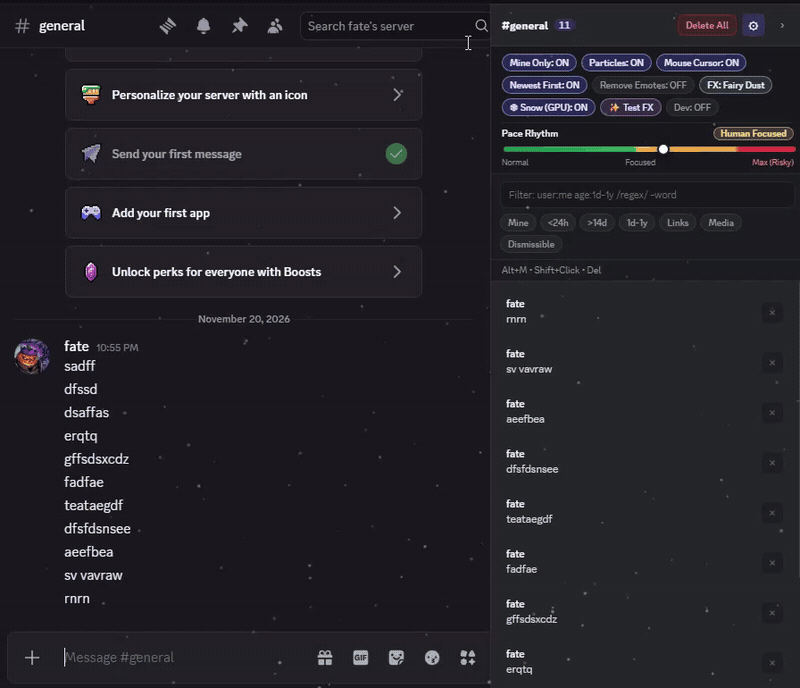

# 🐭 Mouscord

A small Windows app that adds a message-cleanup sidebar to the Discord desktop client, with a little animated mouse that deletes your messages for you.



- **Delete while you do other things:** switch to other channels, DMs, or apps while Mouscord keeps cleaning your locked channel in the background.
- **Animated Mouse companion:** a little mouse with a physics tail and seasonal hat glides over your messages, boops them away with dissolve particles, and celebrates when finished.
- **Find your messages fast:** indexes a whole DM or channel in the background, newest first.
- **Filter:** `is:mine`, `age:>14d`, `age:1d-1y`, `has:link`, `has:media`, `from:bob,alice`, `id:123456...`, `/regex/`, `-word`.
- **Right-click message menu:** filter or exclude by exact User ID, copy User/Message ID (no Developer Mode needed), copy text, jump, or delete.
- **Delete selected or delete all:** supports moderator cleanup in servers where you have `Manage Messages`, retries on rate limits, and verifies with Discord afterwards that nothing was missed.
- **Human-like pacing:** a speed slider from relaxed to max, with natural jitter.
- **Native GPU overlay:** snow, mouse, and dissolve particles render in a separate Direct3D 11 + DirectComposition window, so Discord itself doesn't slow down.
- **Remove your own reactions:** optional toggle to strip your reactions from other people's messages during cleanup.

> [!WARNING]
> Automating a user account goes against [Discord's Terms of Service](https://discord.com/terms). Using this tool could get your account limited or banned. Use it on your own account, at your own risk. This project is not affiliated with or endorsed by Discord.

## How it works

`Mouscord.exe` restarts Discord with the Chrome DevTools debugging port turned on, bound to `127.0.0.1` only, so other devices on your network can't reach it. It then loads the sidebar into the Discord window. Everything runs locally. Nothing is sent anywhere except Discord's own API, using your already logged-in session. Mouscord never reads or stores your token.

## Install

1. Download `Mouscord.exe` from [Releases](../../releases).
2. Run it. Discord restarts, and a mouse icon appears in your system tray.
3. Press **Alt+M** or click the tab on the right edge of Discord.

Windows SmartScreen may warn you because the exe isn't code-signed. If you'd rather not run a downloaded exe, build it yourself (below).

## Shortcuts

| Key | Action |
|---|---|
| `Alt+M` | Open / close the sidebar |
| `Shift+Click` | Select a range |
| `Ctrl+A` | Select all of your messages |
| `Delete` | Delete the selected messages |
| `Space` | Pause / resume deleting |
| `Esc` | Cancel deleting or clear the selection |

## Build from source

Requirements: Windows 10/11, Visual Studio 2022 (or Build Tools) with the C++ workload, and Node.js for the tests.

```powershell
./build.ps1                 # → build/Mouscord.exe
node tests/test_filter.mjs
node tests/test_modules.mjs
```

## Design decisions

**Inject into the real client instead of using a bot or the HTTP API directly.** Deleting through Discord's own in-memory `RestAPI` reuses the client's session, headers and rate-limit handling, and keeps the client's message cache consistent. No token ever leaves Discord's process.

**Loopback DevTools port, not `--remote-debugging-pipe`.** The pipe transport would be ideal, but on Windows, Discord's `Update.exe` re-execs the client and the inherited CRT file descriptors don't survive. A port bound to `127.0.0.1` without `--remote-allow-origins` can't be reached from the LAN or from web pages.

**Pacing.** Discord rate-limits deletes per channel, and older messages (>14 days) are limited more strictly. The engine starts near the known safe interval for each age bucket, backs off multiplicatively on `429`, and recovers slowly after clean streaks (AIMD). A finished run re-queries the server to confirm nothing was missed, because a single dropped `429` would otherwise skip a message silently.

**Indexing.** History is fetched with a dedicated contiguous cursor on `/messages`, separate from `/search` results. Search is used for totals and filter pushdown (`age:`, `has:`), but search pages can have gaps, so they never move the cursor. Concurrent identical requests are coalesced.

**Effects in a separate GPU overlay.** Full-window animated canvases inside Electron are composited with Discord's whole DOM every frame, which made scrolling stutter. The snow, mouse and particles are drawn in a native Direct3D 11 + DirectComposition window placed directly above Discord in the Z-order and made click-through. The page only sends small position and event messages over a DevTools binding. Interactive UI (sidebar, lists) stays in the page because it needs input and Discord's own styling.

**Virtualized list.** The sidebar only mounts the rows in view, so channels with tens of thousands of messages stay responsive.

## Project layout

```
src/main.cpp              Tray app, connects to Discord, loads the modules
src/host/                 DevTools client, Discord launcher, D3D11 GPU overlay
src/js/                   Code that runs inside Discord (sidebar, delete engine, filters, effects)
src/css/                  Sidebar styles
scripts/pack_payloads.ps1 Embeds src/js + src/css into the exe at build time
tests/                    Node unit tests
```

## License

[MIT](LICENSE)

## Support

If Mouscord saved you some time, you can leave a tip on [Ko-fi](https://ko-fi.com/fateofficial187).
